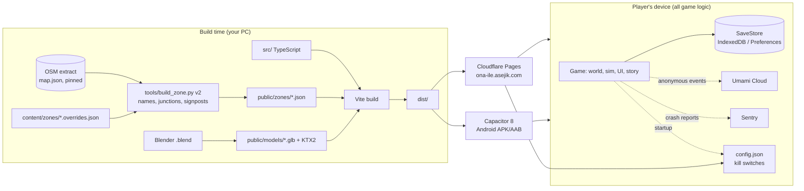

# Ọ̀nà Ilé: Project Plan (P02 Project Blueprint)

Date: 2026-11-07. Mode: **EXISTING, then a rebuild.**
- The prototype v0.1 exists (`baba-keke/`).
- This plan replaces it with a maintainable codebase.
- Marks: **[FOUND]** means checked in code or on your machine. **[ASSUMPTION]** means not yet confirmed.

Inputs:
- [IDEA_BRIEF.md](IDEA_BRIEF.md) and [PROMPT_PLAN.md](PROMPT_PLAN.md);
- the [PRD](https://claude.ai/artifact/DbR5D4bPuhmqcZtjaHE8A1);
- the prototype;
- your P02 phase 1 answers (2026-11-07).

---

## 0. Project Profile

| Field | Value |
|---|---|
| Name | Ọ̀nà Ilé: The Last Delivery (store: "Ona Ile") |
| Type | Public product (passion and portfolio) |
| Owner | You (solo, Ilorin), GitHub `asejik` |
| Platform | Web game (phone and desktop browsers) plus an Android app (Capacitor) |
| Public pages | Yes: the game itself, plus a small landing and credits page |
| Users and scale | Launch: family, friends and Ilorin communities (tens to hundreds). 12 months: hundreds to a few thousand [ASSUMPTION] |
| User locations and laws | Mostly Nigeria (NDPA 2023, GAID 2025), some international. Google Play policies |
| Languages | English UI. Dialogue in English, Pidgin and Yoruba, with English subtitles |
| Personal data | v1.0: **none stored by you.** Anonymous gameplay events and crash reports only (no IDs, no cookies). Saves stay on the device |
| Data protection role | You are the controller. The analytics vendor (Umami Cloud) and crash vendor (Sentry) are processors |
| Major-importance status | v1.0: N/A while no personal data is processed [P03 to confirm]. Online phase: likely Ordinary-High |
| Data hosting regions | Game files: Cloudflare's global CDN. Analytics and crash data: the vendors' regions (EU or US) [P03 to confirm] |
| Payments | v1.0: none. Online phase: Google Play Billing (Android only) |
| AI features | None at runtime |
| Stack | TypeScript, Vite, Three.js. Capacitor 8 for Android. Cloudflare Pages hosting. No backend |
| Key integrations | OpenStreetMap (offline, at build time), Umami Cloud, Sentry |
| Environments | dev (local), preview (a Cloudflare Pages deploy per branch), prod (`ona-ile.asejik.com`, or the free `*.pages.dev`). Android debug and release builds |
| Recovery targets | Server data: none exists. Player saves: on the device, with an export and import save code. Downtime: a day is tolerable (installed apps keep working offline) |
| Rigor level | **STANDARD** (AUDIT_STANDARD §2: usable by the public; no personal data). Online phase: STRICT if it stores data about 13–17-year-olds |

---

## 1. Problem and outcomes

**Problem and goal** (from the brief): Ilorin is almost never seen in games, and outsiders have no warm way into a non-Lagos Nigerian city. You need a finished, public piece of work that brings downloads, reviews, job offers and client leads.

**Success criteria and how to measure them**

| Criterion (90 days after launch) | Measured by |
|---|---|
| 1,000+ web plays | Umami `session_start` events (web) |
| 500+ Play installs | Play Console statistics |
| 4.3★ or better from 30+ reviews | Play Console ratings |
| 5+ quotable Ilorin reactions | Collected by hand from community groups |
| 2+ job or client conversations | Your own log (kept in PROGRESS.md) |
| The slice is finished, not abandoned | Umami `stage_complete` for stage 1, divided by `stage_start` for the prologue |

**User stories** (end-to-end tests are written from these)
1. **As a first-time player on a phone browser,** I open the shared link and am driving within 30 seconds.
   - The title loads in under 10 s on 4G.
   - "Play" leads straight into the intro.
   - Touch controls work in landscape and portrait.
2. **As a driver,** I always know where I am and where junctions lead.
   - The HUD shows the current road name, updating within 1 s of turning.
   - Every named junction has street plates.
   - Each exit at a T-junction or roundabout shows a "to X" signpost.
3. **As a phone player,** I drag anywhere on the screen to drive (ACC-3).
   - Dragging up drives forward, down reverses.
   - The angle mixes steering and throttle, and the length sets the strength.
   - Lifting my finger coasts to a stop.
   - The on-screen buttons still work, and a setting picks between the two.
4. **As a passenger-driver,** I can complete a ride, crash, and see consequences.
   - A ride pays out by stars.
   - Hitting cars, kekes or buildings adds damage scaled by speed.
   - Above 50% the handling degrades, and at 100% the vehicle breaks down.
   - Oga Lati repairs it for Naira.
5. **As a returning player,** my progress is safe.
   - Progress saves automatically on the device.
   - An old `babaKeke.v1` prototype save migrates.
   - I can export a save code and import it on another device.

**Out of scope for v1.0:**
- accounts, leaderboards, purchases, ads;
- multiplayer;
- iOS;
- full voice acting;
- a Yoruba UI;
- any backend;
- zones beyond the seven stages.

---

## 2. Features and scope

Epics use the PRD feature IDs. **MVP** = the vertical slice (Prologue and Stage 1). **Next** = v1.0 (all 7 stages). **Later** = the Online and revenue phase.

| Epic | MVP (slice) | Next (v1.0) | Later |
|---|---|---|---|
| Driving and controls | Keke physics, keyboard, touch buttons, **ACC-3 swipe-to-drive** | ACC-1 gamepad and tilt, more vehicles | — |
| Wayfinding | NAV-1 current street, NAV-2 plates, NAV-3 signposts, NAV-5 minimap and full map | NAV-4 turn hints, NAV-6 area cards | — |
| Ride loop | CORE-1 rides, CORE-2 wardens, CORE-3 Memory Book (ported from v0.1), **CORE-4 passengers easy to find, CORE-5 roadside pickup and drop-off, HUD-1 mission tracker** | STORY-2 Respect groups | — |
| Damage | DMG-1 meter, DMG-3 handling, DMG-4 repairs, **REAL-5 potholes** | DMG-2 visuals, DMG-5 argument scene | — |
| Challenges | TIME-1 timed challenges (2–3 in the slice) | TIME-2 board with best times, TIME-3 time of day | Online leaderboards |
| World | Zone pipeline v2, Prologue and Stage 1 zones, REAL-1 Post Office, **REAL-2 living streetscape (more vehicles, people and roadside activity)** | Stages 2–7 zones and landmarks, REAL-3 | — |
| Story | Prologue and Stage 1 dialogue, Baba as a 3D character, portraits | STORY-1 all stages and cutscenes | — |
| Platform | Web deploy, Android APK, SYS-1 save and settings, save code export, ACC-2, PERF-1 | Play production release | iOS, in-app purchases, accounts |
| Diagnostics | Crash reports and anonymous events (after P03) | — | — |

Why each MVP item is in: the slice has to prove the three things the playtest asked for (knowing where you are, damage, timed runs), plus the new control scheme you asked for, on both web and Android. Anything else waits.

**Porting the prototype.** Every v0.1 feature is **[FOUND]** in `baba-keke/index.html`:

| v0.1 feature | Section in `index.html` |
|---|---|
| Road graph, Dijkstra routing, collision | §1 |
| Scene building | §2 |
| Cast and dialogue | §3 |
| localStorage save under `babaKeke.v1`, WebAudio SFX | §4 |
| Pickup, haggle, trip and stars | §6 |
| Wardens and traffic | §7 |
| Minimap and HUD | §8 |
| Touch buttons | §9 |

Half-built: the building lift and level-of-detail, landmarks (plain blocks), and junction names (not computed yet).

---

## 3. Users, roles and permissions

There is one role: **player**. There are no accounts, logins or admin in v1.0. Settings and saves belong to the device.

The Online phase adds a player account (nickname, no email) and account deletion in the app and on the web. It is designed in that phase's P02 update.

---

## 4. Data model (on the device)

| Entity | Key fields | Stored in | Owner |
|---|---|---|---|
| `Save` | `schemaVersion`, `createdAt`, `updatedAt` (UTC ISO), `stage`, `naira` (integer ₦), `respect` (per group, 0–100), `stars` (per stage), `memoryPages` (ids), `damage` (0–100), `vehicle`, `challengeBest` (challengeId → ms), `flags` (story) | Web: IndexedDB. Android: Capacitor Preferences. Both behind one `SaveStore` interface | The device |
| `Settings` | `controlScheme` (swipe, buttons or both), `steerSensitivity`, `textSize`, `subtitles`, `graphicsQuality`, `sound` and `music` volumes, `analyticsOptIn` (see §9) | Same store | The device |
| `SaveCode` | Base64url of the compressed `Save` plus a checksum. No personal data | Shown and typed by the player | The player |
| `Zone` (read-only, built offline) | `id`, `bounds`, `nodes`, `roads` (name, width, one-way, roundabout), `junctions` (**new:** name, `exits[]` with heading and "leads to"), `buildings`, `spots`, `notebook`, `challenges`, `attribution` | `public/zones/<id>.json`, generated | You (ODbL derived data) |
| `ZoneOverrides` (hand-made) | Landmark models, props, spawns, challenge markers, name fixes | `content/zones/<id>.overrides.json` | You |

Rules:
- Money is an integer number of naira. Times are stored in UTC.
- `schemaVersion`, plus a migration chain, starts at v2. The migrator imports `babaKeke.v1`.
- No personal data in any entity. The DATA_INVENTORY lists only diagnostics.
- Access rules: N/A, since there's no server database.
- Existing data to import: `babaKeke.v1` saves (a one-time migration) and `zone1.js` (regenerated by pipeline v2, not imported).

---

## 5. Tech stack

**Engine choice**

| | **A. Three.js + TypeScript + Vite** (recommended) | B. Godot 4 (web export) |
|---|---|---|
| Cost | Free (MIT) | Free (MIT) |
| Learning curve | Low: v0.1 already runs on it | New editor and GDScript |
| Mobile web performance | Good. The v0.1 test ran well [FOUND by you]. Small bundle (~150 KB gzip for the core) | Heavier web export (WASM, ~10–40 MB), slower start in phone browsers [UNVERIFIED] |
| Android | Capacitor wraps the same build | Native export, and faster on Android |
| AI coding tools | Very reliable for TypeScript and Three.js | Less reliable for GDScript 4 |
| Lock-in | Low (plain web) | Medium (engine-specific scenes) |
| Data hosting | N/A | N/A |

**Recommendation: A.** The web build being first-class decides it. Godot stays the fallback if PERF-1 fails inside the Android app.

**Libraries and services**

| Need | Choice | Notes |
|---|---|---|
| Language and build | TypeScript (strict), Vite | Node 24 is installed [FOUND] |
| 3D | `three` (pinned), with `GLTFLoader` and `KTX2Loader` from its examples | Bundled locally, not loaded from a CDN (PROMPT_PLAN check-only item) |
| UI and HUD | Plain TypeScript and DOM with CSS tokens (as in v0.1) | **Skip React.** The HUD is small, and React adds weight and two render loops |
| Physics | Custom arcade physics (ported) | Skip a physics engine. Revisit only if vehicles need real suspension |
| Saves | `idb-keyval` (web) and `@capacitor/preferences` (Android) | Both tiny |
| Android wrapper | Capacitor 8 (targetSdk 36, JDK 21) | Meets Play's API 36 rule. Version details per [Capgo](https://capgo.app/ko/blog/troubleshooting-capacitor-android-build-errors/) and the [Capacitor target SDK docs](https://capacitorjs.com/docs/next/android/setting-target-sdk) [UNVERIFIED on the official docs] |
| Assets | glTF made in Blender, meshopt compression, KTX2 textures | Fits the 5 MB-per-zone budget |
| Fonts | Baloo 2 and Nunito, **self-hosted** (OFL) | Removes the Google Fonts request that exists today [FOUND] |
| Tests | Vitest (unit), Playwright (smoke) | — |
| Lint | ESLint and Prettier, plus `tsc --noEmit` | — |
| Map pipeline | Python 3.13 (`tools/build_zone.py` v2) | Python 3.13.7 is installed [FOUND] |
| Hosting | **Cloudflare Pages**, free plan | Static assets free and unmetered. 500 builds a month per account, 25 MiB maximum per file, about 20,000 files per site ([limits](https://developers.cloudflare.com/pages/platform/limits)) [UNVERIFIED: confirm the free file count]. Zones stay well under 25 MiB. Custom domain `ona-ile.asejik.com` through a CNAME |
| Anonymous analytics | **Umami Cloud**, free tier | Cookieless, supports custom events. The free limit is reported as 10k–100k events a month, depending on the source ([overview](https://dasroot.net/posts/2026/03/privacy-preserving-analytics-plausible-umami-goatcounter/)) [UNVERIFIED: check umami.is]. Has to be tested inside the Capacitor app (origin `https://localhost`) |
| Crash reports | **Sentry**, free developer tier | all `dataCollection` categories off (Sentry 11 replaced `sendDefaultPii`), IP storage off, no session replay. Free quota about 5k errors a month [UNVERIFIED: check the pricing page] |

**Native mobile**
- Play Console personal account: US$25 one-off fee. You need 12+ closed testers for 14 days before production.
- Review times: hours to a few days.
- Updates ship as store releases, with a staged rollout. There are no over-the-air updates, because shipping code outside the store adds review risk.
- **Sideloaded APK sharing (your plan before Play) works today.** Google is extending developer verification to sideloaded apps on certified devices **globally in 2027** ([Android Authority](https://www.androidauthority.com/android-sideloading-changes-timeline-3679204/)). Verify your developer identity in Play Console early, so community APKs keep installing.
- **Your machine:** the Android SDK is at `D:\Android` [FOUND]. The `java` on your PATH is **JDK 8** [FOUND]. Capacitor 8 needs JDK 21, which is the JDK that recent Android Studio versions bundle. Milestone 1 sets `JAVA_HOME` to Studio's bundled JDK. Most builds then run from the command line (`npx cap run android`), so you'll rarely have to wait for Android Studio to open.

---

## 6. Architecture

**Code layout** (modules replace the v0.1 sections):

| Path | Contents |
|---|---|
| `src/world/` | Zone loading, road graph, routing, collision, signposts |
| `src/sim/` | Vehicle physics, traffic, wardens, damage, challenges. Pure logic, unit-tested |
| `src/render/` | Three.js scene, models, camera, level of detail |
| `src/ui/` | HUD, minimap, dialogue, menus, the input layer (keyboard, buttons, swipe) |
| `src/story/` | Cast, lines, stage scripts |
| `src/platform/` | SaveStore, analytics, crash reporting, config |

- **What runs where:** everything runs on the device. There is no server code in v1.0.
- **Secrets:** none are needed. Umami website IDs and the Sentry DSN are public identifiers by design, not secrets. Rate abuse on them is a vendor-side concern. Nothing secret goes into the bundle.

**Third-party failure modes**

| Dependency | If it's down |
|---|---|
| Cloudflare | The web build is unavailable. The installed APK still works |
| Umami or Sentry | Events are dropped silently, and the game is unaffected |
| OSM | Only affects building new zones (the extracts are pinned in the repo) |

**Kill switches:** `config.json` is served next to the game and fetched at startup with a short timeout. It controls:
- `analytics`, `crashReports`: turn either one off;
- `minVersion`: tells old app builds to update.

A cached copy is used offline. Flip a value in the repo, push, and the change is live without an app release.

---

## 7. AI features

N/A. There is no AI at runtime. (AI is a build tool only. Any AI-drafted art or text is reviewed by hand, and S2 checks its licences.)

---

## 8. Error handling and reliability

| Category | What the player sees | What the system does | What gets logged |
|---|---|---|---|
| Zone or model fails to load | "Couldn't load the map. Check your connection." with a Retry button | Retries twice with backoff. The APK loads from bundled files | Sentry: zone id, HTTP status |
| WebGL unavailable or context lost | "Your browser paused the 3D view. Tap to resume." | Rebuilds the renderer. If WebGL is missing, shows a help card | Sentry: GPU string, device model |
| Offline | Nothing; the game keeps working | Events queue in memory, then are dropped | — |
| Save write fails (quota, private mode) | A small toast: "Progress couldn't be saved on this browser. Use Save code." | Keeps the state in memory and offers export | Sentry: error class only |
| Corrupt save or bad save code | "That save code isn't valid" or "Save repaired" | Checksum check, migration, fallback to the last good copy | Sentry: schemaVersion |
| App backgrounded mid-challenge | The challenge pauses and shows a "Resume" card | Pauses the timer on `visibilitychange` | — |
| Outdated APK | An "Update available" card | Compared against `config.json` `minVersion` | — |

Loading, empty and error states are designed in P05-B: the title loader, the zone loader, an empty Memory Book, a challenge board with no best times, and the error cards above.

**No personal data in logs.** The Sentry `beforeSend` strips everything except the error, the game version and the device class.

---

## 9. Security, privacy and compliance (by design)

**Top threats**

| Threat | Mitigation |
|---|---|
| Supply-chain compromise (npm, CDN) | Pinned dependencies, lockfile, Dependabot, no CDN at runtime (P04, P08 §11) |
| A leaked signing key, or someone else publishing "your" app | Upload key kept offline and backed up, Play App Signing (S1 §3) |
| Account takeover of GitHub, Cloudflare, Google or Play | MFA on every one (P04 item 10, P08 §1) |
| Cheating in challenges | Harmless offline. The time check matters only when leaderboards arrive |
| Unwanted tracking | Cookieless, ID-free analytics. Analytics events carry no identifier |
| Unfair or offensive portrayal | S2 review, plus local readers |

**Privacy features to build.** Confirmed by P03 LIGHT DESIGN on 2026-11-07. Details are in [DATA_INVENTORY.md](DATA_INVENTORY.md).

| ID | Feature | Milestone | Acceptance criteria (check by playing) |
|---|---|---|---|
| PRIV-1 | Diagnostics stay off by default | M1 | In a fresh browser profile, Playwright records **no** requests to Sentry or Umami before a choice is made, after **No thanks**, or with no age confirmation. The Network tab shows only first-party and Cloudflare requests |
| PRIV-2 | 18+ check, then the consent prompt | M1 (stub), M2 (final UI) | It appears once, after the first paid ride: "Are you 18 or older?" If No or skipped, it never asks again and diagnostics stay off. If Yes, two separate toggles appear (crash reports, play stats), **both off**, with **Save choice** and **No thanks** buttons of equal weight. The text says what is sent, to whom (Sentry EU, Umami), that it leaves Nigeria, and links to the notice |
| PRIV-3 | Consent record | M1 | The saved settings hold `{crash, stats, at, noticeVersion, ageConfirmed18}`. When `noticeVersion` changes, the game asks again |
| PRIV-4 | Easy withdrawal | M2 | Settings has a Privacy section with the same two toggles. Switching off stops sending immediately (no Sentry or Umami requests afterwards), and the SDKs don't load on the next launch |
| PRIV-5 | Crash-report scrubbing | M1 | All Sentry `dataCollection` categories off, IP storage off in Sentry project settings, breadcrumbs and replay off, and an allow-list `beforeSend`. A forced test error in Sentry shows no IP, no user, and no save-code text |
| PRIV-6 | Analytics allow-list | M5 | Only the 5 event names in DATA_INVENTORY §1, with only the allowed properties. A unit test fails if any other name or property is sent. No custom free-text properties |
| PRIV-7 | Privacy notice page | M1 (draft), M6 (final, after DPO review) | `/privacy` page on the web, linked from the title screen, Settings and the consent prompt. Contains every item in P03 card part 8: controller, contact, lawful bases, data types, purposes, means, processors, transfers, retention, rights, how to complain to the NDPC, and the under-18 rule. It matches DATA_INVENTORY exactly |
| PRIV-8 | Pre-install privacy statement | M7 | The Play listing description and the in-app first launch carry the GAID Art. 31 items: data types, purpose, minimum data only, measures (HTTPS, no IDs), the DPIA outcome, the in-app privacy link, how to uninstall, and how to complain |
| PRIV-9 | Data safety form | M7 | Answers match DATA_INVENTORY (collected: crash logs and app interactions, optional, not shared, encrypted in transit). Re-checked whenever an SDK changes |
| PRIV-10 | Self-hosted fonts and no runtime CDN | M1 | No requests to fonts.googleapis.com, fonts.gstatic.com or jsdelivr in the Network tab |
| PRIV-11 | Kill switch | M1 | Setting `analytics:false` or `crashReports:false` in `config.json` stops sending on the next launch without a new release |
| PRIV-12 | Bug-report template | M0 (P04) | The GitHub issue template asks for device, steps and a screenshot, and says "don't include your name or phone number" |

**Paperwork and governance** (P03 section L). Status as of 2026-11-07. ✋ means you do it.

| Item | Applies? | Status | When |
|---|---|---|---|
| Engage an NDPC-accredited DPO (also needed to sign the DPIA) | Yes | ✋ Not started. Get 2–3 quotes | Before M5 ends |
| DPIA (GAID Art. 31, Schedule 4 template), signed by the DPO | **Yes, mandatory before deployment** | Not started. P03 AUDIT produces `docs/privacy/DPIA_INPUT.md` for the DPO | Signed **before the M6 community release** |
| Major-importance assessment and NDPC registration (OHL ₦10,000 a year) | Possibly (DPO to decide) | ✋ Pending the DPO's view | Before M6, if it applies |
| Compliance audit within 15 months of starting, then yearly | Yes, for every controller (card part 2) | Not due | Within 15 months of the M6 release |
| Compliance Audit Returns through a DPCO | Only for UHL/EHL | N/A unless the tier rises | — |
| Semi-annual data protection report | Yes (card part 2) | Not due | Every 6 months after release |
| Internal privacy policy and checklist | Yes, short for a sole controller | Not started | With the DPIA |
| Data protection training | Required for sole proprietors doing high-risk processing. v1.0 isn't high-risk [DPO] | ✋ Optional now. Do it before the Online phase | Before the Online phase |
| DPAs with processors | Yes | ✋ Accept Cloudflare's, Sentry's and Umami's DPAs in their dashboards | M1, when the accounts are created |
| Breach procedure (72 h to the NDPC, ngCERT within 72 h) | Yes | Written in P13 Part A | Before the M6 release |

- No sign-ups, emails or names are collected anywhere.
- The OSM credit appears on the title and credits screens (S2 §1).

---

## 10. Non-functional requirements

**Performance** (PERF-1, PRD budgets, on a 3–4 GB Android phone):
- 30 fps or better;
- at most 300k triangles and 150 draw calls on screen;
- at most 5 MB per zone, compressed;
- zone load under 10 s;
- install under 150 MB.

Web title screen: LCP under 3 s on a 4G profile. JS bundle under 400 KB gzip, excluding zones and models.

**Low bandwidth:**
- lazy-load the stage zones;
- cache them (HTTP cache, and a service worker after the slice);
- show download size before fetching a stage on the web.

**Accessibility** (game-adapted WCAG basics):
- subtitles on by default;
- text size setting;
- STOP/GO shown by shape as well as colour;
- colour-blind-safe route line;
- remappable keys (later);
- a reduced-motion option for camera shake.

**SEO:** title, meta and Open Graph for the landing page (P11 LIGHT).

**Recovery:** there is no server data to lose. Player saves are on the device, and the save code is the backup. A day of downtime is tolerable on the web, and none applies to the APK.

---

## 11. Quality and operations

**Tests**
- **Unit tests (Vitest)** for logic that's easy to break silently:
  - routing (next-hop tree);
  - signpost text (exit leads to X);
  - fare and star maths;
  - damage scaling and repair cost;
  - challenge timing (pause handling);
  - save migration and save-code round trips.
- **Pipeline test:** `build_zone.py` over the pinned extract must match the counts and checksum recorded in CI.
- **Playwright smoke tests:**
  1. Title, then play, then the intro dialog closes.
  2. The `__keke`-style debug hook teleports the player to a pickup, and the trip completes and pays out.
  3. Save, reload, and progress is still there.
  4. Export a save code, clear storage, import it, and progress is restored.
  5. A 360 px portrait viewport with the swipe drag moves the vehicle.

**Environments:** dev (`npm run dev`), preview (a Cloudflare Pages deploy per branch), prod (`main`). Android: a debug APK for you and testers, and a release AAB for Play.

**Checks on every change** (P04 item 3): typecheck, lint, unit tests, the pipeline check, build, and Playwright smoke tests.

**Monitoring:** Sentry alerts by email. Umami dashboards are tied to §1's criteria.

**Backups:** the Git remote covers code and content. Blender source files are large, so keep them out of Git, in two places (an external drive and cloud storage) [ASSUMPTION: you choose where].

---

## 12. Build plan

Effort: **S** = a few sessions. **M** = 1–2 weeks at a few hours a day. **L** = 3+ weeks.

| # | Milestone | Goal and tasks | Done when (you can check this by playing) | Effort | Prompts |
|---|---|---|---|---|---|
| **M0** | Paperwork | P03 LIGHT DESIGN (diagnostics, notice, consent). P04 setup (repo, CI, MFA, Dependabot, secret scanning). P05-A extracts the prototype's design system | `docs/DATA_INVENTORY.md` complete, `docs/SETUP.md` written, `docs/DESIGN.md` exists | S | P03, P04, P05-A |
| **M1** | **Walking skeleton** | Vite + TS repo in `asejik/ona-ile`. Three.js bundled. Load `zone1` as JSON and drive a box keke on the roads. Deploy to Cloudflare Pages and the custom domain. Capacitor Android debug APK. Sentry wired (diagnostics consent stub). `config.json` kill switch. CI green | You open `ona-ile.asejik.com` on your phone **and** install the APK, and both drive smoothly. A test error appears in Sentry | M | P06 |
| **M2** | Port the ride loop and controls | **CORE-4, CORE-5 and HUD-1** (second playtest, 2026-11-11). Port v0.1 physics, traffic, wardens, rides, notebook, HUD and audio into modules, with unit tests. SaveStore with v1 migration. **ACC-3 swipe-to-drive** plus buttons plus a setting. Save code export and import | Everything v0.1 did works in the new build, and swipe driving feels right on your phone | L | P05-B (controls UI first), P06 |
| **M3** | Wayfinding (riskiest new logic) | **Spike first:** pipeline v2 computes junction names and "leads to" for each exit on zone1. Then NAV-1 banner, NAV-2 plates, NAV-3 signposts, NAV-5 full map | At 5 random junctions, the plates and signposts match the real roads (check with a local) | M | P06 |
| **M4** | Damage and challenges | **REAL-5 potholes.** DMG-1, DMG-3, DMG-4 (Oga Lati), TIME-1 with 2–3 challenges and bronze, silver and gold | A crash dents your progress, repairs cost money, and "Post Office to Sadiku in 2 min" works | M | P06 |
| **M5** | Slice content and look | **REAL-2 living streetscape, within the performance budget.** Stage 1 zone (Geri-Alimi) built and dressed. REAL-1 Post Office model. **Art spike:** Baba as a glTF character end to end. Prologue and Stage 1 dialogue with portraits. Settings, ACC-2, credits and the OSM line. Anonymous events | A stranger plays the Prologue into Stage 1 with no help, and the Post Office is recognisable | L | P06, S2 §1–2 (zone data) |
| **M6** | Slice hardening and community release | Performance pass on your phone (both builds). Service-worker caching. Fixes from the audits. P03 AUDIT, then the **DPIA signed by the DPO**. Final privacy notice. Share the **web link and APK** with family, friends and communities | MID audits closed for HIGH findings. DPIA signed. 20+ community players. Feedback logged | M | P07 MID, P09 LIGHT, P08 LIGHT, P14 short |
| **M7** | Play closed test | Play Console, signing, Data safety, content rating, and 12+ testers for 14 days | Play approves production access | S, plus 14 days of waiting | S1, P14 short |
| M8+ | Stages 2–7 | One milestone per stage: zone, landmark, story, mechanic (haggling, fragile cargo, multi-passenger, race, hill, the 504) | Each stage is playable end to end and reviewed by a local | L each | P06. S2 per new zone |
| Final | v1.0 launch | Pre-launch audits, P11, P13 Part A, P14 | P14 says GO | M | See PROMPT_PLAN steps 15–23 |
| Later | Online and revenue | Re-run P00, then a P02 update, then purchases, leaderboards and accounts | — | — | PROMPT_PLAN steps 26–32 |

**Riskiest parts are tackled early:**
- performance in Capacitor (M1 runs on a real phone);
- signpost generation (M3 opens with a spike);
- the character art pipeline (the M5 spike, which can start during M2 because it's Blender work).

---

## 13. Client delivery

N/A. This is your own project.

---

## 14. Risks and open questions

| Risk | Likelihood | Impact | Mitigation | Early warning |
|---|---|---|---|---|
| Scope outgrows a solo builder | High | High | The slice is a finished product (M6). Stage milestones are independent | M2 takes more than 4 weeks |
| The Capacitor WebView is slower than Chrome | Medium | High | M1 tests on a real phone. A low-detail mode. Godot as a last resort | Under 25 fps in the APK |
| Signposts are wrong because of OSM gaps | Medium | Medium | Overrides file, local checks, fixes contributed back to OSM | A local says "that road doesn't go there" |
| Art pipeline too slow or poor | Medium | Medium | Portraits plus simple in-world figures (PRD fallback) | The Baba spike takes more than 2 weeks |
| Free-tier limits change (Umami, Sentry, Cloudflare) | Low | Low | Kill switch. Diagnostics are optional | A vendor email or dashboard warning |
| Sideload verification (2027) blocks community APKs | Medium (2027) | Medium | Verify your developer identity in Play Console early, and move testers to the Play track | Google announcements for Nigeria |
| Android Studio is slow on your PC | Medium | Low | Command-line builds (`npx cap run android`). Open Studio only for the emulator or signing | — |

**Decisions still needed (yours):**
1. ✅ Repo name settled on 2026-11-07: `asejik/ona-ile`. The subdomain follows as `ona-ile.asejik.com` [ASSUMPTION: confirm].
2. Whether art, music and story files live in the public repo under "all rights reserved", or in a separate private repo (the P04 default is the public repo with a split licence).
3. Where Blender source files are backed up.

---

## 15. Decisions log

| Decision | Alternatives | Why |
|---|---|---|
| Three.js + TS + Vite | Godot 4, Babylon.js | Proven in v0.1, light on mobile web, strong AI-tooling support. Godot is kept as the fallback |
| No React for the UI | React or Preact | A small HUD, avoids a second render loop and extra weight |
| Custom arcade physics | Rapier, cannon-es | Simple vehicles, already working. Fewer dependencies |
| Capacitor 8 | Trusted Web Activity, Cordova | One codebase, offline bundled assets, Play Billing plugins available later |
| Cloudflare Pages | GitHub Pages, Netlify, Vercel | Your choice. Unmetered static bandwidth on the free plan, a fast CDN for large zone files |
| Zones as JSON in `public/` | Keep `window.ZONE` JS | Lazy loading, caching, testable, works in Capacitor |
| Umami (events) + Sentry (crashes), ID-free and behind consent | Firebase/Google Analytics, no analytics | Measures the success criteria without identifiers, keeps P03 light. Firebase adds device IDs |
| Save code export | Cloud saves | Protects progress with no account or personal data |
| Fonts self-hosted | Google Fonts CDN | Privacy (no IP sent to Google) and offline use |
| Public repo | Private | ODbL share-alike, portfolio visibility. Creative assets can be licensed separately |
| v1.0 offline and free | Online features from the start | Scope and compliance load (P01) |
| Lawful basis: consent for diagnostics, necessity and legitimate interest for hosting logs | Legitimate interest for analytics | Consent also covers the transfer abroad (no NDPC adequacy list exists), and it's cheap to ask (P03) |
| Diagnostics only for players who confirm they're 18+ | Guardian consent, or asking everyone | Under-18s are children under the NDPA. Not collecting from them is simpler than guardian consent (P03) |
| Sentry EU region, Umami Cloud (region to verify), with a fallback to no gameplay events | Firebase or Google Analytics | ID-free, EU where possible. Removing collection beats justifying it (P03) |
| DPIA before the M6 community release | DPIA before the Play launch | GAID Art. 31: before deployment, and the community release is deployment (P03) |
